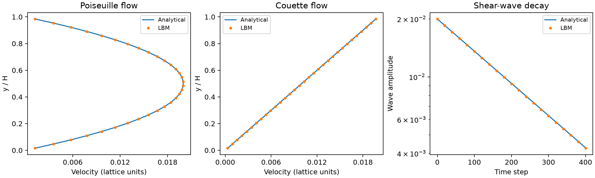
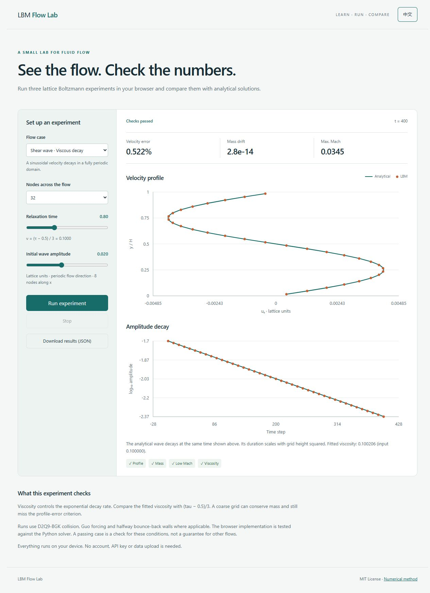

# LBM Flow Lab

Three small flow problems for learning and checking the lattice Boltzmann method. A shared D2Q9-BGK solver handles collision, streaming, body forcing and straight walls. Each case compares the computed flow with an analytical solution.

[中文说明](README.zh-CN.md) · [Numerical method](docs/method.md) · [Results](examples/RESULTS.md)

[Interactive browser experiments](demo/index.html) · [Poiseuille refinement study](examples/CHANNEL_STUDY.md)

| Case | Flow | What it checks |
|---|---|---|
| Poiseuille | Force-driven flow between fixed plates | Body force, wall placement, parabolic velocity profile |
| Couette | Flow driven by a moving top plate | Moving-wall boundary and linear velocity profile |
| Shear wave | Decay of a sinusoidal velocity in a periodic domain | Streaming, viscous decay and the relaxation-time viscosity relation |



## Install and run

For a browser-only introduction, open `demo/index.html` from a downloaded checkout. It runs the three experiments locally, with adjustable parameters, live diagnostics and downloadable JSON results. The JavaScript solver is cross-checked against Python. See [browser instructions and hosting](demo/README.md). GitHub's file viewer displays HTML source; an administrator can enable GitHub Pages to serve the page.



Requires Python 3.11 or later. From the project folder:

```sh
python -m pip install -e .
lbm-lab all --output runs
```

On Windows, use `py` in place of `python` if needed. To run one case:

```sh
lbm-lab poiseuille --output channel-run
lbm-lab couette --output moving-wall-run
lbm-lab shear-wave --output wave-run
```

Each command creates a case subdirectory under the requested output folder, plus `summary.json`. Choose a new or empty output folder for each run. The command returns exit code 0 when all requested cases meet their criteria and 1 when any case fails. Numerical inputs that cannot be used return a command-line error.

## Read the output

- `comparison.png`: computed velocity against the analytical profile, plus profile error or wave decay.
- `profile.csv`: coordinates, computed velocity, analytical velocity and their difference.
- `history.csv`: sampled mass, Mach number, density extrema, kinetic energy and wave amplitude.
- `fields.npz`: final density and velocity arrays, indexed `[y, x]`, and the reference profile.
- `config.json`: parameters and software versions.
- `report.json`: error measures, convergence status and individual acceptance checks.

The wall cases start from rest and stop when the maximum velocity change over a 100-step checkpoint interval, divided by the configured speed, falls below 1e-8. Reaching `--max-steps` without meeting this condition is reported as a failure. The shear wave runs for a specified duration and is compared at that exact time.

## Change parameters

```sh
lbm-lab poiseuille --ny 48 --tau 0.8 --speed 0.01 --max-steps 50000 --output fine-channel
lbm-lab shear-wave --ny 64 --speed 0.01 --wave-steps 1600 --output fine-wave
```

| Option | Default | Meaning |
|---|---:|---|
| `--ny` | 32 | Fluid nodes across the channel or periodic wave |
| `--nx` | 8 | Periodic nodes along the flow |
| `--tau` | 0.8 | BGK relaxation time, greater than 0.5 |
| `--speed` | 0.02 | Continuum channel peak, top-wall speed, or initial wave amplitude |
| `--max-steps` | 20000 | Maximum steps for a wall case |
| `--wave-steps` | 400 | Steps for the shear wave; use at least 40 for the viscosity fit |

All quantities are in lattice units, with dx = dt = 1 and reference density 1. The viscosity is `nu=(tau-0.5)/3`. The default narrow x-domain is enough for these fully developed, x-independent flows; these cases do not exercise general 2D flow around obstacles. A larger grid may need a larger step limit. Numerical stability is not guaranteed for arbitrary positive parameters.

## Grid refinement

```sh
python -m lbm_lab.refinement --output refinement-run
```

The study runs the shear wave on 16, 32 and 64 nodes in y. Velocity scales as 1/N and duration as N², keeping Reynolds number and viscous time fixed. The checked-in results show approximately second-order profile-error reduction for this case. The 16-node case misses the 1% profile criterion and is retained in the report. The study command returns success if errors decrease; individual benchmark acceptance is reported separately. See [results](examples/RESULTS.md).

## Teaching sequence

For the channel's grid and relaxation-time study, run:

```sh
python -m lbm_lab.channel_study --output channel-study-run
```

This compares nine steady cases at fixed Reynolds number. Parameters, measured errors and original output are in the [study report](examples/CHANNEL_STUDY.md).

1. Run Couette flow and locate the two walls relative to the fluid nodes.
2. Run Poiseuille flow and compare the effect of the body force with the moving wall.
3. Run the shear wave, infer viscosity from the decay rate and compare it with the input value.
4. Refine the wave grid at matched viscous time. Compare error as well as the visual overlap of the curves.

Start with [solver.py](src/lbm_lab/solver.py) for the nine lattice directions, equilibrium, collision and streaming. [cases.py](src/lbm_lab/cases.py) supplies initial conditions, reference solutions and reporting. Method details and formulas are in [docs/method.md](docs/method.md).

## Development

```sh
python -m unittest discover -s tests -v
python -m pip install build ruff
ruff check src tests
python -m build
```

CI is configured to run tests and the default benchmarks on Linux and Windows with Python 3.11 and 3.14. Local results are recorded separately from hosted CI results. Contributions should include a reproducible command and tests for numerical changes. See [CONTRIBUTING.md](CONTRIBUTING.md). Licensed under [MIT](LICENSE).
