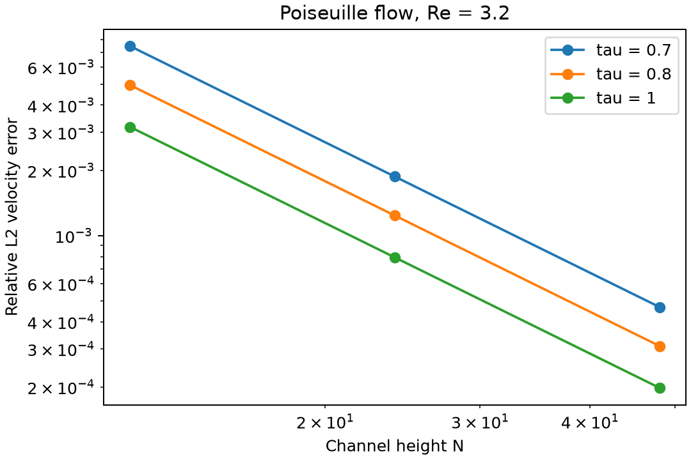

# Poiseuille grid and relaxation-time study

```sh
python -m lbm_lab.channel_study --output channel-study-run
```

The study runs nine steady channels: N=12, 24, 48 and tau=0.7, 0.8, 1.0. Within each tau group, viscosity is fixed, peak speed scales as 1/N and force density as 1/N³. The channel-height Reynolds number U*N/nu is 3.2 throughout. x remains periodic with eight nodes because the imposed flow is fully developed and x-independent.



| tau | Error at N=12 | Error at N=24 | Error at N=48 | Observed orders |
|---|---:|---:|---:|---|
| 0.7 | 0.74803% | 0.18701% | 0.04675% | 1.99997, 1.99999 |
| 0.8 | 0.49446% | 0.12362% | 0.03090% | 1.99997, 1.99999 |
| 1.0 | 0.31696% | 0.07924% | 0.01981% | 1.99997, 2.00001 |

Errors are relative L2 differences from the unmodified continuum parabolic profile at fluid-node coordinates y=j+0.5. All nine cases reached the stricter checkpoint velocity-change tolerance of 1e-10 and passed the usual benchmark checks. Step limits scale with N²/nu, and cases start from rest. The actual step counts and original profiles are saved in `channel-study/`.

The errors decrease approximately quadratically along this diffusive refinement path. Their magnitude also depends on tau, consistent with the relaxation sensitivity of BGK halfway bounce-back in this setup. Comparing tau groups is not a recommendation that a larger tau is always better: viscosity, forcing and speed differ between groups to keep Reynolds number fixed, and other flows can behave differently. The study measures steady profile error, not independent time convergence or general two-dimensional accuracy.

Results were produced on Windows/Python 3.14 with NumPy 2.5.4. Values come from `channel-study/study.json` and the individual case reports.

## 中文说明

固定 Reynolds 数为 3.2，分别在 tau=0.7、0.8、1.0 下加密通道横向网格。每组内速度按 1/N、力密度按 1/N³ 缩放；所有算例从静止开始，达到稳态后与原始抛物线解析解比较。

九组均满足稳态停止条件，误差在本次加密路径上约按二阶下降。不同 tau 的误差大小不同，但这不意味着所有问题都应该选更大的 tau；跨组时黏度、速度和力项也随之变化。这是直壁、充分发展流动的稳态验证，不是通用精度保证。
