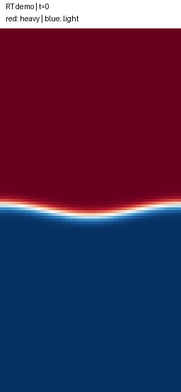
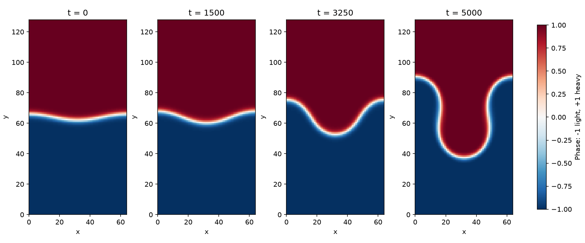
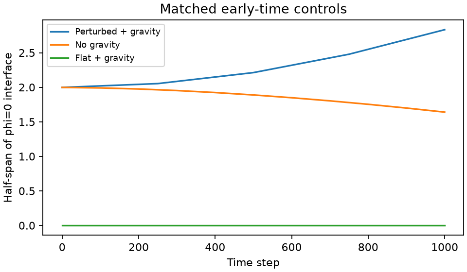

# Rayleigh-Taylor: low-Atwood exploratory case

Heavy material initially lies above light material. A sinusoidal displacement grows under downward gravity. This case couples a conservative diffuse-interface equation to the existing D2Q9-BGK flow solver under the Boussinesq approximation.

**Status: exploratory demonstration.** Conservation, basic controls and numerical guards have been checked. A published benchmark, grid refinement and quantitative growth-rate validation have not been completed. This case is intentionally separate from the four analytical benchmarks in `lbm-lab all`.



## Run

```sh
python -m lbm_lab.rayleigh_taylor --output rt-run
```

Python 3.11+ is required; install the package as described in the main README. Default output includes an animated GIF, a four-panel figure, interface/conservation diagnostics, CSV history, NPZ phase snapshots, parameters and a report. A new or empty output directory is required. The browser also implements this model in JavaScript; choose Rayleigh–Taylor in the flow selector and click Run experiment. The recorded animation below remains the original 5000-step Python reference.

```sh
# Same geometry, zero gravity; capillary forces remain active.
python -m lbm_lab.rayleigh_taylor --gravity 0 --steps 1000 --every 100 --output rt-no-gravity-run
# Gravity active, no initial interface perturbation.
python -m lbm_lab.rayleigh_taylor --amplitude 0 --steps 1000 --every 100 --output rt-flat-run
```

The command returns zero for a completed run and nonzero on a numerical guard failure. Completion is not a benchmark pass. On guard failure, the report identifies the failing step and the last saved time; saved snapshots remain available.

## Model

All quantities are in lattice units, with dx=dt=rho_ref=1. The phase phi is approximately +1 in heavy material and -1 in light material:

```text
dphi/dt + div(phi u) = M laplacian(mu)
mu = beta (phi³ - phi) - kappa laplacian(phi)
F_capillary = -phi grad(mu)
F_buoyancy = (0, -Atwood * gravity * phi)
```

Density contrast enters buoyancy only. Inertia and viscosity use the reference fluid; the small LBM density variations represent weak compressibility and pressure, not the material density contrast. Atwood=0.05 corresponds to a nominal material density ratio of (1+A)/(1-A), approximately 1.105, but this is **not** a variable-density two-fluid solver.

The free energy is the integral of `beta*(phi²-1)²/4 + kappa*|grad(phi)|²/2`. The continuum planar-interface estimates are tanh width `sqrt(2*kappa/beta)=2` and surface tension `(2*sqrt(2)/3)*sqrt(kappa*beta)=0.0013333` for the defaults. They are parameter estimates, not measured discrete surface tension.

The flow uses Guo forcing with both force components, the half-force velocity correction, periodic x and halfway no-slip walls at y=0 and y=ny. A horizontally averaged initial pressure approximately balances the initial vertical force. It is not an exactly well-balanced hydrostatic discretization.

Phase transport uses conservative limited face fluxes, finite-difference chemical-potential diffusion and SSP-RK2. phi and mu have zero normal face gradients at the y-walls; advective flux through them is zero. The flow and phase updates are operator split. No clipping or mean-composition correction is applied. The method has no demonstrated discrete total-energy law or general stability guarantee; parameter checks are only a stiffness screen.

## Default parameters and measured results

| Parameter | Value |
|---|---:|
| Grid | 64 × 128 |
| Steps / snapshot interval | 5000 / 250 |
| tau / kinematic viscosity | 0.65 / 0.05 |
| Atwood / gravity | 0.05 / 0.0004 |
| Initial displacement amplitude | 2 |
| Mobility M | 2 |
| beta / kappa | 0.001 / 0.002 |

The initial interface is `y=ny/2 + amplitude*cos(2*pi*x/nx)` with a tanh profile. The run completed 5000 steps. Its sampled maximum Mach number was 0.03295, maximum mean-phase drift 1.11e-16, and maximum relative fluid-mass drift 4.27e-13. The phi=0 interface extent grew from approximately [62.00, 66.00] to [37.38, 90.62]. These are interpolated extrema over all vertical zero crossings, not tagged material-particle trajectories. Small phase overshoots are retained in the CSV; final extrema are approximately -1.012 and +1.012.



## Controls



Controls use the same grid, tau and phase parameters but end at step 1000. The comparison truncates the main run to this same time. Zero gravity retains capillary dynamics and phase diffusion; its initial corrugation relaxes rather than developing buoyancy-driven growth. With a flat initial interface and gravity, the interface stays horizontally uniform to roundoff over these 1000 steps. This is not a long-time stability guarantee, and no artificial noise is added to the flat control.

Original output is stored in `rayleigh-taylor/` and `rayleigh-taylor-controls/`. Runs used Windows/Python 3.14 and NumPy 2.5.4.

## Before using quantitatively

Check spatial resolution and interface thickness, mobility, force discretization, time splitting, domain and wall effects, capillary equilibrium and calibrated surface tension. Compare an appropriate viscous diffuse-interface growth rate or a fully specified published benchmark. The inviscid sharp-interface expression alone is not a pass criterion for this viscous, finite-width, wall-bounded case. High Atwood numbers, material-specific predictions, nonlinear roll-up accuracy and long-time mixing rates are outside the present validation scope.

The numerical guards stop if |phi| exceeds 1.5 or Mach exceeds 0.15. They do not guarantee accuracy below those bounds. The checked-in run shows interface growth; no mushroom roll-up or turbulence benchmark is claimed.

## Background

Celani et al., *Phase-field model for the Rayleigh-Taylor instability of immiscible fluids*, [arXiv:0806.0783](https://arxiv.org/abs/0806.0783), describes a low-Atwood phase-field/flow formulation. This code is an educational finite-difference/LBM implementation, not a reproduction of that paper's numerical method or results.

## 中文说明

这是低 Atwood 数、Boussinesq 近似下的探索算例：密度差只进入浮力，不是变密度两流体求解器。界面由守恒 Cahn-Hilliard 方程描述，速度由 D2Q9-BGK 求解。已检查基本守恒、无重力和无扰动对照，尚未完成网格、界面厚度敏感性或公开基准验证。

红色代表重相，蓝色代表轻相。默认运行显示界面扰动增长，并保留真实误差和相场超调。动画来自已保存的 Python 计算，不是网页实时两相模拟。`lbm-lab all` 仍只运行四个具有解析参考的单相案例。

## Live browser experiment

The browser defaults to 64 × 128 cells and 10000 steps. Choose 5000, 10000, 20000 or 30000 steps, and gravity 0, 0.0002 or 0.0004. Atwood=0.05, tau=0.65, amplitude=2, M=2, beta=0.001 and kappa=0.002 are fixed. Smaller widths are available, but shortening the wavelength with fixed surface tension can suppress growth. These controls do not define a grid-refinement study.

The field is recomputed in a worker, with progress every 100 steps. Stop cancels the worker. Completed-run JSON contains final phase, sampled interface heights, conservation history and configuration; it has no benchmark `passed` flag. A phase or Mach guard terminates a run and keeps the last displayed sample marked incomplete. A completed run is not a quantitative validation.

A local Node.js run at the default geometry and gravity completed 20000 steps. Maximum Mach was 0.0629992, maximum relative fluid mass drift 1.7482e-12, and maximum sampled mean phase drift 9.98e-16. At step 10000 the zero-crossing bounds were [3.5757, 124.4243]; at 20000 they were [0.7153, 127.2847]. Wall interaction therefore matters at late times. The 30000-step choice is an optional duration, not a claim of validated late-time physics or stability for every setting. The automated cross-language check compares the phase field and interface bounds after 100 steps at 32 × 64.
