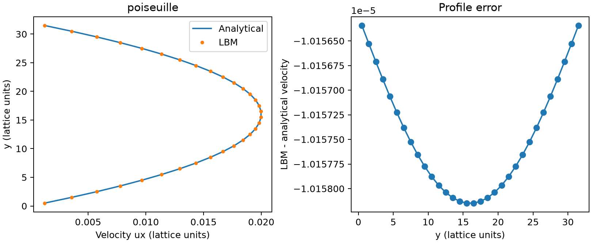
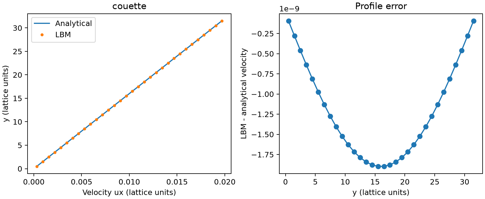
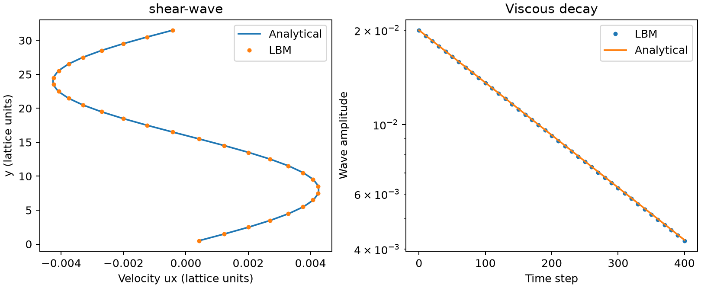
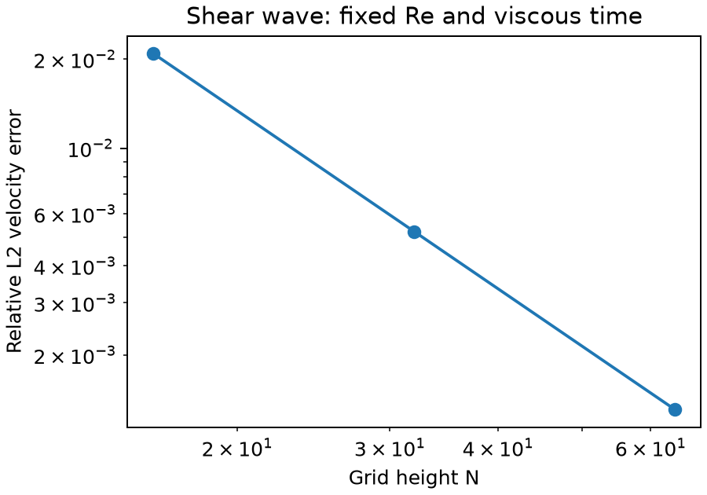

# Benchmark results

These results were produced on Windows with Python 3.14 and NumPy 2.5.4. All values can be checked in the JSON and CSV files alongside each figure.

## Default suite

```sh
lbm-lab all --output reproduced-default
```

The default suite uses nx=8, ny=32, tau=0.8 (nu=0.1), speed=0.02 and at most 20000 wall-case steps. Both wall cases start from rest. Shear-wave duration is 400 steps. All three cases passed their declared criteria.

| Case | Steps | Relative L2 velocity error | Maximum sampled relative mass drift |
|---|---:|---:|---:|
| Poiseuille | 16800 | 0.06954% | 1.10e-12 |
| Couette | 16300 | 0.00001163% | 1.05e-12 |
| Shear wave | 400 | 0.52249% | 2.80e-14 |

The wave's fitted viscosity is 0.10020626, differing by 0.20626% from the input value. The maximum sampled Mach number across the suite is below 0.035.

### Poiseuille



The near-constant profile offset is retained in the error plot. It is small at this resolution but not removed by fitting a different force or channel height.

### Couette



The remaining small difference reflects the finite steady-state stopping criterion and floating-point effects. This straight-wall case alone does not validate curved or general moving boundaries.

### Shear wave



The final profile and amplitude decay are compared with the continuum solution. Viscosity is fitted from steps 20–400; the final-profile comparison still includes the effect of kinetic startup.

## Coarser grid

The earlier nx=8, ny=24 run is retained in `reference/`. Reproduce it with:

```sh
lbm-lab all --ny 24 --output reproduced-n24
```

Its channel cases passed, but the shear wave's final profile error was 1.3644%, above the 1% threshold, so the overall report is a failure. Its viscosity error was 0.3676%. This is why the default suite uses 32 rather than 24 y-nodes. The two grids at the same step count do not represent a matched viscous-time convergence study; use the study below for that comparison.

## Matched refinement study

```sh
python -m lbm_lab.refinement --output reproduced-refinement
```



| N | Initial amplitude | Steps | Viscous time nu*t/N² | Relative L2 velocity error | Benchmark passed |
|---|---:|---:|---:|---:|---|
| 16 | 0.04 | 100 | 0.0390625 | 2.08740% | No |
| 32 | 0.02 | 400 | 0.0390625 | 0.52249% | Yes |
| 64 | 0.01 | 1600 | 0.0390625 | 0.13066% | Yes |

Reynolds number U*N/nu is 6.4 in each run. Observed profile-error orders are approximately 1.9982 and 1.9995. These are results for a smooth, x-independent shear wave along a diffusive refinement path. They are not an independent time-convergence result or a guarantee for other geometries and flow regimes.

The directory contains both passing and failing reports. The refinement command checks decreasing error separately from individual-case thresholds; it does not turn a failed coarse benchmark into a passing one.
