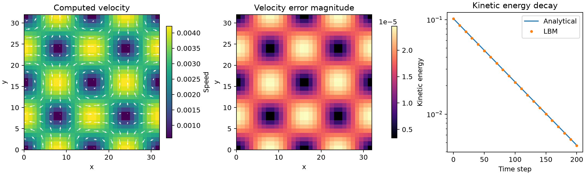

# Two-dimensional Taylor-Green vortex

```sh
lbm-lab taylor-green --output vortex-run
# Standalone runner:
python -m lbm_lab.taylor_green --output vortex-run
```

Defaults: 32 × 32 square grid, tau=0.8, speed amplitude U=0.02, 200 steps. Both directions are periodic. Coordinates are x=i+0.5, y=j+0.5, k=2pi/N.

```text
ux = -U cos(kx) sin(ky) exp(-2 nu k² t)
uy =  U sin(kx) cos(ky) exp(-2 nu k² t)
p - p0 = -U²/4 [cos(2kx) + cos(2ky)] exp(-4 nu k² t)
E = N² U²/4 exp(-4 nu k² t)
```

Initial density is rho=1+3(p-p0), consistent with lattice pressure rho/3. This reduces acoustic startup but does not make the incompressible reference an exact weakly compressible or discrete-LBM solution. Populations use equilibrium initialization; kinetic startup and finite-Mach effects remain.



| Quantity | Measured default result |
|---|---:|
| Full vector-field relative L2 velocity error | 0.57639% |
| Final kinetic-energy relative error | 1.14915% |
| Input viscosity | 0.1 |
| Fitted viscosity | 0.10010910 |
| Viscosity relative error | 0.10910% |
| Maximum sampled relative mass drift | 1.38e-14 |

The run passed predeclared thresholds: velocity error <1%, energy error <2%, viscosity error <1%, mass drift <1e-10 and sampled Mach <0.1. Amplitude is projected from the full velocity field onto its initial pattern. The viscosity fit uses samples from step 20 onward and amplitude decay rate 2 nu k². Numerical energy is sum(rho*(ux²+uy²)/2); the continuum energy assumes reference density one.

Original fields, parameters and history are in `taylor-green/`. This run used Windows/Python 3.14 and NumPy 2.5.4. It checks smooth periodic two-dimensional flow, not walls or turbulence. No vortex grid-convergence claim is made in this version.

The browser uses N × N nodes, with duration round(200*N²/32²). It shows full-field error above a slice at x=0.5. The slice does not determine pass/fail. Arrow lengths rescale each frame to keep directions visible; speed colors retain the initial-amplitude scale.

## Reference

Velocity and pressure conventions follow the 2D example in Mei et al., *Consistent initial conditions for lattice Boltzmann simulations* (2006), [publisher page](https://www.sciencedirect.com/science/article/abs/pii/S0045793005001477). This code's equilibrium initialization is simpler than the consistent initialization methods studied there.

## 中文说明

该算例在正方形全周期域内演化二维涡旋。速度误差使用所有节点的 ux、uy，动能按实际密度加权。网页上的剖面只是 x=0.5 的切片。初始密度由解析压力给出，但仍有弱可压缩和动力学启动误差。默认结果达到本项目阈值，不代表任意网格和参数都已验证。
